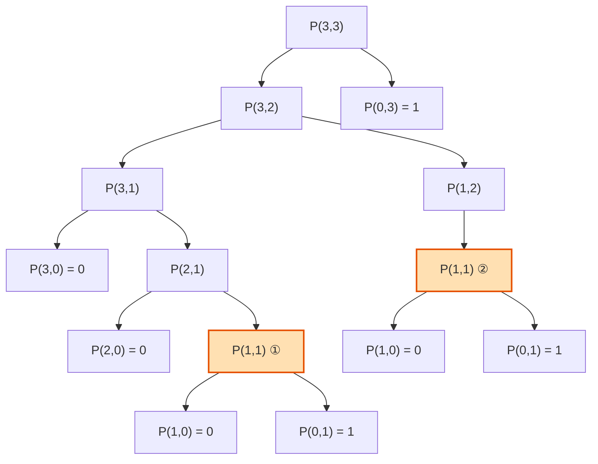
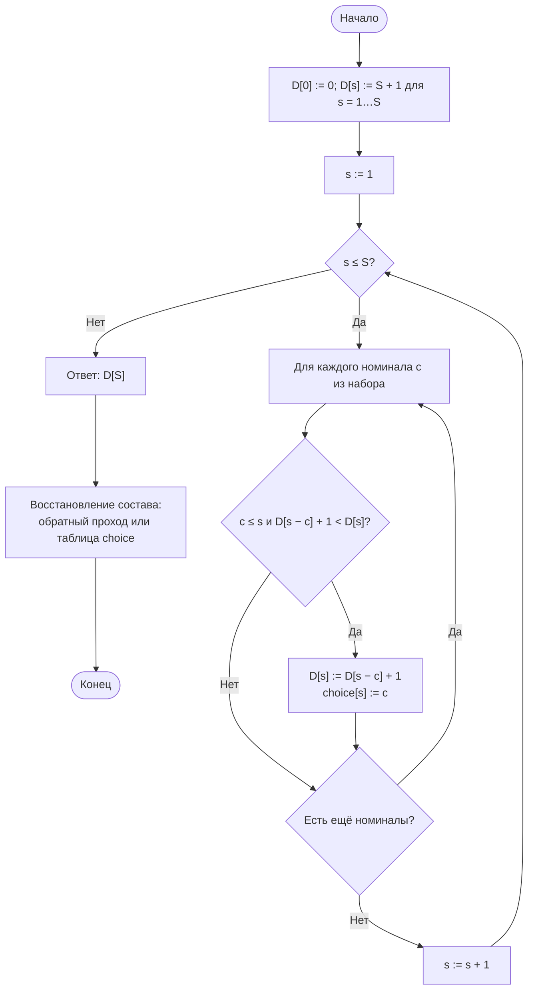
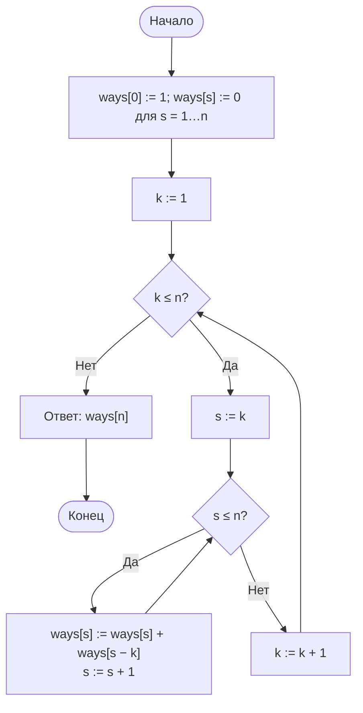
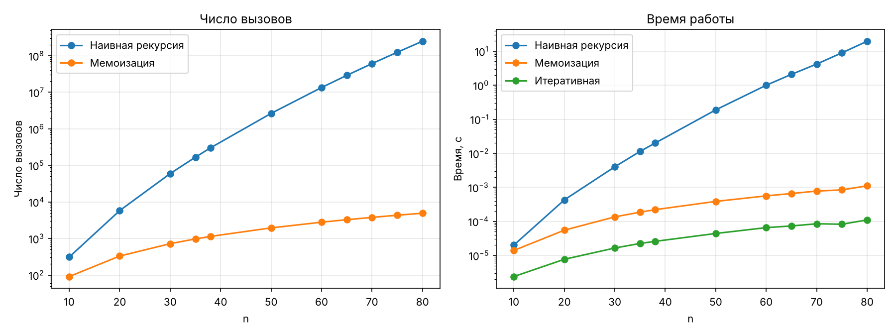

# Отчёт по лабораторной работе № 7

## Рекурсивные алгоритмы и динамическое программирование в задачах комбинаторной оптимизации

---

## 1. Титульный лист

| | |
|---|---|
| **Дисциплина** | Теория алгоритмов |
| **Направление подготовки** | 38.03.05 «Бизнес-информатика» |
| **Курс** | 2 |
| **Лабораторная работа** | № 7. Рекурсивные алгоритмы и динамическое программирование в задачах комбинаторной оптимизации |
| **Вариант** | 19 |
| **Выполнила** | Ситникова Ольга, группа БИ2-1 |
| **Проверил** | ______________________ |
| **Год** | 2026 |

---

## 2. Цель работы и задание варианта

**Цель работы:** изучить метод динамического программирования как способ устранения повторных вычислений в рекурсивных алгоритмах и экспериментально сопоставить трудоёмкость трёх реализаций одной задачи — наивной рекурсивной, рекурсивной с мемоизацией и итеративной.

**Задание варианта 19:**

| Параметр | Значение |
|---|---|
| Задача А (три реализации) | число разбиений числа $n$ на слагаемые |
| Параметр $n$ задачи А | до 38 (в работе дополнительно доведён до предела наивной рекурсии) |
| Задача Б (динамическое программирование) | размен суммы минимальным числом монет |
| Данные задачи Б | сумма $S = 300$, номиналы 1, 7, 11 |
| Дополнительное задание | Г5 — восстановление решения двумя способами: обратным проходом по таблице и хранением выбора в отдельной таблице; сравнение расхода памяти |

**Что выполнено:**

1. Задача А реализована тремя способами (наивная рекурсия, мемоизация, итеративное ДП) с подсчётом числа вызовов функции.
2. Построено дерево рекурсии для малого параметра с отмеченными повторяющимися подзадачами.
3. Измерено время трёх реализаций, определён предел наивной рекурсии (ориентир — 10 с).
4. Задача Б решена методом ДП, оптимальное решение восстановлено и расшифровано.
5. Результат ДП сверен с полным перебором для малых сумм.
6. Выполнено дополнительное задание Г5.

---

## 3. Рекуррентные соотношения задач

### 3.1. Задача А: число разбиений числа

**Разбиением** числа $n$ называется его представление в виде суммы натуральных слагаемых без учёта порядка (например, $4 = 3 + 1 = 2 + 2 = 2 + 1 + 1 = 1 + 1 + 1 + 1$ и $4$; всего $p(4) = 5$ разбиений). Пусть $P(n, k)$ — число разбиений числа $n$ на слагаемые, **не превосходящие $k$**. Тогда искомое число разбиений $p(n) = P(n, n)$, а

$$P(n, k) = \begin{cases} 1, & n = 0, \\[4pt] 0, & n > 0,\ k = 0, \\[4pt] P(n,\ k-1), & 0 < n < k, \\[4pt] P(n,\ k-1) + P(n-k,\ k), & n \ge k > 0. \end{cases}$$

Пояснение каждой ветви:

| Ветвь | Смысл |
|---|---|
| $P(n, k) = 1$ при $n = 0$ | Сумма набрана: единственное (пустое) разбиение нулевого остатка |
| $P(n, k) = 0$ при $n > 0$, $k = 0$ | Остаток есть, а допустимых слагаемых нет: разбиений нет |
| Слагаемое $P(n, k-1)$ | Разбиения, **не содержащие** слагаемого $k$: все слагаемые не больше $k - 1$ |
| Слагаемое $P(n-k, k)$ | Разбиения, содержащие слагаемое $k$ **хотя бы один раз**: отнимаем одно слагаемое $k$ и разбиваем остаток $n - k$ на слагаемые не больше $k$ |
| Ветвь $0 < n < k$ | Слагаемое $k$ больше остатка и использоваться не может: остаётся только первое слагаемое |

Два случая («$k$ не входит» и «$k$ входит») не пересекаются и исчерпывают все разбиения, поэтому их числа складываются. Задача А — задача **подсчёта**, а не оптимизации; метод ДП здесь применим из-за **перекрывающихся подзадач**: одно и то же $P(m, j)$ встречается в разных ветвях дерева рекурсии.

Три реализации:

| Реализация | Идея | Число вызовов / операций |
|---|---|---|
| `p_naive` | прямая рекурсия по соотношению | число узлов дерева рекурсии |
| `p_memo` | то же с кэшем результатов в словаре `{(n, k): значение}` | пропорционально числу различных пар $(n, k)$, то есть $\Theta(n^2)$ |
| `p_iter` | восходящее ДП по одномерному массиву `ways[s]` | $\Theta(n^2)$ операций, $O(n)$ памяти |

В итеративной версии массив `ways[s]` последовательно обновляется для $k = 1, 2, \ldots, n$ по правилу `ways[s] += ways[s - k]`; это та же рекуррентность $P(s, k) = P(s, k-1) + P(s-k, k)$, записанная «по месту» (при переходе от $k-1$ к $k$ строка таблицы перезаписывается).

### 3.2. Задача Б: размен суммы

Дана система номиналов $c_1, \ldots, c_m$ (в варианте 19: 1, 7, 11) и сумма $S = 300$. Требуется набрать $S$ минимальным числом монет. Пусть $D[s]$ — минимальное число монет, которым можно набрать сумму $s$:

$$D[0] = 0, \qquad D[s] = 1 + \min_{c_j \le s} D[s - c_j], \quad s = 1, \ldots, S.$$

Пояснение:

| Слагаемое | Смысл |
|---|---|
| $D[0] = 0$ | Для нулевой суммы монет не нужно (база динамики) |
| $\min_{c_j \le s}$ | Перебор номиналов, которые не превышают текущую сумму $s$: последней в наборе может быть любая такая монета |
| $D[s - c_j]$ | Оптимальное решение подзадачи — минимум монет для суммы, оставшейся после выбора последней монеты $c_j$ (**оптимальная подструктура**) |
| $1 +$ | Сама последняя монета $c_j$ |

Так как в системе есть номинал 1, любая сумма набирается, и значение $D[s]$ не превосходит $s$; поэтому в программе начальное значение «бесконечность» заменено числом $S + 1$.

Трудоёмкость: $\Theta(mS)$ времени ($m = 3$ номинала) и $\Theta(S)$ памяти.

**Восстановление решения (Г5)** двумя способами:

1. **Обратный проход по таблице $D$.** Начиная с $s = S$, находится монета $c$, для которой $D[s - c] = D[s] - 1$, она добавляется в ответ, и $s := s - c$. Дополнительных таблиц не требуется, на каждом шаге проверяются до $m$ номиналов.
2. **Таблица выбора `choice`.** При заполнении $D$ для каждой суммы запоминается монета, давшая минимум: $\text{choice}[s] = \arg\min D[s - c_j]$. Восстановление — цепочка $s \to s - \text{choice}[s]$, на каждом шаге одна операция, но хранится ещё одна таблица длины $S + 1$.

Оба способа используют одно правило выбора при равенстве (наименьший номинал), поэтому дают **одинаковый** набор монет.

---

## 4. Дерево рекурсии для малого параметра

Дерево вызовов `p_naive(3, 3)`: левый потомок — $P(n, k-1)$, правый — $P(n-k, k)$. В листьях указано возвращаемое значение. Подзадача $P(1,1)$ (выделена цветом) решается **дважды**.



Значения по дереву снизу вверх: $P(1,1) = 1$, $P(2,1) = 1$, $P(3,1) = 1$, $P(1,2) = 1$, $P(3,2) = 1 + 1 = 2$, $P(3,3) = 2 + 1 = 3 = p(3)$ (разбиения $3$, $2+1$, $1+1+1$).

Дерево содержит 14 узлов и 6 уровней. С ростом $n$ повторов становится всё больше: например, при $n = 5$ подзадача $P(1,1)$ вычисляется уже **5 раз**, $P(2,1)$ — 3 раза, $P(3,1)$ — 2 раза. При мемоизации второй вызов $P(1,1)$ возвращает значение из кэша без раскрытия потомков, поэтому вместо 14 вызовов выполняется 12; для $n = 38$ экономия составляет уже 302 673 → 1141 вызов.

---

## 5. Схемы заполнения таблиц динамического программирования

### 5.1. Задача Б: размен суммы



**Фрагмент таблицы** (получен программой), $s = 0 \ldots 22$:

| $s$ | 0 | 1 | 2 | 3 | 4 | 5 | 6 | 7 | 8 | 9 | 10 | 11 |
|---|---|---|---|---|---|---|---|---|---|---|---|---|
| $D[s]$ | 0 | 1 | 2 | 3 | 4 | 5 | 6 | 1 | 2 | 3 | 4 | 1 |
| `choice[s]` | — | 1 | 1 | 1 | 1 | 1 | 1 | 7 | 1 | 1 | 1 | 11 |

| $s$ | 12 | 13 | 14 | 15 | 16 | 17 | 18 | 19 | 20 | 21 | 22 |
|---|---|---|---|---|---|---|---|---|---|---|---|
| $D[s]$ | 2 | 3 | 2 | 3 | 4 | 5 | 2 | 3 | 4 | 3 | 2 |
| `choice[s]` | 1 | 1 | 7 | 1 | 1 | 1 | 7 | 1 | 1 | 7 | 11 |

Пример вычисления: $D[18] = 1 + \min(D[17], D[11], D[7]) = 1 + \min(5, 1, 1) = 2$ (монеты 7 и 11).

### 5.2. Задача А: итеративная версия



---

## 6. Листинг программы

Файл `lab7_variant19.py` (Python 3.10+, для графиков нужна библиотека `matplotlib`). Каждая строка снабжена комментарием.

```python
"""Лабораторная работа № 7. Вариант 19. Ситникова Ольга, группа БИ2-1."""
import platform  # сведения о компьютере
import sys  # sys.getsizeof для размера таблиц
import time  # замер времени
import tracemalloc  # пик расхода памяти
from collections import Counter  # подсчёт монет каждого номинала
from itertools import product  # перебор для проверки ДП
import matplotlib.pyplot as plt  # графики

SUM, COINS = 300, [1, 7, 11]  # задача Б: сумма и номиналы по варианту 19
calls = 0  # счётчик вызовов рекурсивных функций


def p_naive(n, k):  # число разбиений n на слагаемые не больше k: наивная рекурсия
    global calls  # используем глобальный счётчик
    calls += 1  # считаем вызов
    if n == 0:  # нечего разбивать: одно (пустое) разбиение
        return 1  # базовый случай
    if k == 0:  # слагаемых не осталось, а n > 0
        return 0  # разбиений нет
    res = p_naive(n, k - 1)  # разбиения без слагаемого k
    if n >= k:  # слагаемое k можно использовать
        res += p_naive(n - k, k)  # разбиения, где k есть хотя бы один раз
    return res  # сумма двух случаев


def p_memo(n, k, cache):  # то же с мемоизацией (нисходящее ДП)
    global calls  # используем глобальный счётчик
    calls += 1  # считаем вызов
    if n == 0:  # базовый случай
        return 1  # одно разбиение
    if k == 0:  # слагаемых не осталось
        return 0  # разбиений нет
    if (n, k) not in cache:  # подзадача ещё не решена
        cache[n, k] = p_memo(n, k - 1, cache) + (p_memo(n - k, k, cache) if n >= k else 0)  # решаем и запоминаем
    return cache[n, k]  # берём результат из кэша


def p_iter(n):  # итеративное решение (восходящее ДП): Θ(n²) операций, O(n) памяти
    ways = [1] + [0] * n  # ways[s] — число разбиений s на уже рассмотренные слагаемые
    for k in range(1, n + 1):  # по очереди разрешаем слагаемое k
        for s in range(k, n + 1):  # обновляем все суммы, куда k помещается
            ways[s] += ways[s - k]  # добавляем разбиения суммы s - k со слагаемым k
    return ways[n]  # ответ для n


def timed(func, repeats):  # результат, лучшее время из повторов (с) и число вызовов функции func
    global calls  # используем глобальный счётчик
    times = []  # времена повторов
    for _ in range(repeats):  # несколько повторов
        calls = 0  # обнуляем счётчик вызовов
        t0 = time.perf_counter()  # начало замера
        res = func()  # запуск
        times.append(time.perf_counter() - t0)  # длительность повтора
    return res, min(times), calls  # результат, лучшее время (наименее искажённое помехами), вызовы


def coins_dp(total, coins, with_choice=False):  # размен: D[s] — минимум монет для суммы s
    D = [total + 1] * (total + 1)  # «бесконечность»: ответ не больше total, так как есть монета 1
    D[0] = 0  # для суммы 0 нужно 0 монет
    choice = [0] * (total + 1) if with_choice else None  # таблица выбора: какая монета дала минимум
    for s in range(1, total + 1):  # суммы по возрастанию
        for c in coins:  # перебираем номиналы
            if c <= s and D[s - c] + 1 < D[s]:  # монета подходит и улучшает результат
                D[s] = D[s - c] + 1  # D[s] = 1 + min D[s - c]
                if with_choice:  # нужна таблица выбора
                    choice[s] = c  # запоминаем монету
    return D, choice  # таблица значений и (при необходимости) таблица выбора


def restore_backtrack(D, total, coins):  # восстановление 1: обратный проход по таблице D
    res, s = [], total  # набранные монеты и остаток суммы
    while s > 0:  # пока сумма не разобрана
        c = next(c for c in coins if c <= s and D[s - c] == D[s] - 1)  # монета, ведущая к оптимуму
        res.append(c)  # добавляем монету
        s -= c  # уменьшаем остаток
    return res  # список монет


def restore_choice(choice, total):  # восстановление 2: по таблице выбора
    res, s = [], total  # набранные монеты и остаток суммы
    while s > 0:  # пока сумма не разобрана
        res.append(choice[s])  # берём сохранённую монету
        s -= choice[s]  # уменьшаем остаток
    return res  # список монет


def coins_brute(total, coins):  # полный перебор для проверки ДП (малые суммы)
    best = None  # лучшее найденное число монет
    for cnt in product(*(range(total // c + 1) for c in coins)):  # все наборы количеств монет
        if sum(n * c for n, c in zip(cnt, coins)) == total and (best is None or sum(cnt) < best):  # набор даёт сумму и лучше
            best = sum(cnt)  # запоминаем число монет
    return best  # минимальное число монет


def peak(func):  # пиковый расход памяти при выполнении func, байт
    tracemalloc.start()  # включаем отслеживание
    func()  # запуск
    top = tracemalloc.get_traced_memory()[1]  # пик
    tracemalloc.stop()  # выключаем отслеживание
    return top  # байт


if __name__ == "__main__":  # запуск только при прямом старте файла
    print(platform.platform(), "|", platform.processor() or platform.machine(), "| Python", platform.python_version())  # система
    print("\nЗадача А: число разбиений числа n")  # заголовок части А
    print("  n | наивная, с | вызовов | мемо, с | вызовов | итер., с | p(n) | вызовов/p(n)")  # заголовок таблицы
    rows = []  # строки результатов для графиков
    for n in [10, 20, 30, 35, 38, 50, 60, 65, 70, 75, 80]:  # значения из варианта (до 38) и далее для поиска предела
        r1, t1, c1 = timed(lambda: p_naive(n, n), 3 if n <= 38 else 1)  # наивная рекурсия
        r2, t2, c2 = timed(lambda: p_memo(n, n, {}), 21)  # мемоизация
        r3, t3, _ = timed(lambda: p_iter(n), 21)  # итеративная версия
        assert r1 == r2 == r3  # все три способа дают один ответ
        rows.append((n, t1, c1, t2, c2, t3))  # сохраняем строку
        print(f"{n:>3} | {t1:>10.4f} | {c1:>9} | {t2:>7.5f} | {c2:>7} | {t3:>8.6f} | {r1:>9} | {c1 / r1:>5.1f}")  # печать строки
        if t1 > 10:  # наивная версия вышла за ориентир 10 с
            print(f"Наивная рекурсия не укладывается в 10 с при n = {n}")  # предел найден
            break  # дальше не продолжаем
    print("\nЗадача Б: размен суммы", SUM, "номиналами", COINS)  # заголовок части Б
    for s in range(41):  # сверка ДП с полным перебором на малых суммах
        assert coins_dp(s, COINS)[0][s] == coins_brute(s, COINS)  # результаты должны совпасть
    print("Сверка ДП с полным перебором для S = 0..40: совпадение")  # итог сверки
    D, choice = coins_dp(SUM, COINS, True)  # решаем задачу с сохранением выбора
    print("Фрагмент таблицы D[0..22]:", D[:23])  # начало таблицы значений
    sol1, sol2 = restore_backtrack(D, SUM, COINS), restore_choice(choice, SUM)  # два способа восстановления
    assert sol1 == sol2 and sum(sol1) == SUM and len(sol1) == D[SUM]  # решения совпадают и корректны
    print(f"Минимум монет: {D[SUM]}; состав: {dict(sorted(Counter(sol1).items(), reverse=True))}")  # ответ с расшифровкой
    print("\nПамять восстановления (Г5), байт: пик tracemalloc и размер таблиц")  # заголовок сравнения
    for total in (SUM, 100_000):  # заданная сумма и большая сумма для наглядности
        m1 = peak(lambda: restore_backtrack(coins_dp(total, COINS)[0], total, COINS))  # способ 1: одна таблица
        m2 = peak(lambda: restore_choice(coins_dp(total, COINS, True)[1], total))  # способ 2: две таблицы
        Dt, Ct = coins_dp(total, COINS, True)  # таблицы для оценки размера списков
        print(f"  S = {total}: обратный проход {m1}, таблица выбора {m2}, список D {sys.getsizeof(Dt)}, список choice {sys.getsizeof(Ct)}")  # вывод
    fig, (ax1, ax2) = plt.subplots(1, 2, figsize=(12, 4.5))  # два графика рядом
    ns = [r[0] for r in rows]  # значения n
    ax1.plot(ns, [r[2] for r in rows], "o-", label="Наивная рекурсия")  # вызовы наивной версии
    ax1.plot(ns, [r[4] for r in rows], "o-", label="Мемоизация")  # вызовы мемоизации
    ax1.set(xlabel="n", ylabel="Число вызовов", title="Число вызовов", yscale="log")  # оформление
    ax2.plot(ns, [r[1] for r in rows], "o-", label="Наивная рекурсия")  # время наивной версии
    ax2.plot(ns, [r[3] for r in rows], "o-", label="Мемоизация")  # время мемоизации
    ax2.plot(ns, [r[5] for r in rows], "o-", label="Итеративная")  # время итеративной версии
    ax2.set(xlabel="n", ylabel="Время, с", title="Время работы", yscale="log")  # оформление
    for ax in (ax1, ax2):  # общее оформление
        ax.grid(True, alpha=0.3)  # сетка
        ax.legend()  # легенда
    plt.tight_layout()  # убираем наложение подписей
    plt.savefig("lab7_graphs.png", dpi=150)  # сохраняем график для отчёта
    plt.show()  # показываем график на экране
```

---

## 7. Таблицы измерений и графики

**Условия измерений:** Linux (Ubuntu 24.04), Intel Xeon @ 2,10 ГГц (1 виртуальное ядро), 3 ГБ ОЗУ, Python 3.12.3, matplotlib 3.11. Время измерялось `time.perf_counter()`; для каждого значения берётся лучшее из нескольких повторов (3 для наивной версии при $n \le 38$, 1 при $n > 38$, 21 для мемоизации и итеративной версии). Число вызовов определяется глобальным счётчиком.

### 7.1. Задача А: три реализации

**Таблица 1. Число разбиений $p(n)$: время и число вызовов**

| $n$ | Наивная, с | Вызовов | Мемоизация, с | Вызовов | Итеративная, с | $p(n)$ | Вызовов наивной / $p(n)$ |
|---|---|---|---|---|---|---|---|
| 10 | < 0,0001 | 311 | 0,00001 | 91 | 0,000002 | 42 | 7,4 |
| 20 | 0,0004 | 5800 | 0,00006 | 331 | 0,000008 | 627 | 9,3 |
| 30 | 0,0040 | 59 653 | 0,00014 | 721 | 0,000016 | 5604 | 10,6 |
| 35 | 0,0114 | 167 924 | 0,00019 | 972 | 0,000022 | 14 883 | 11,3 |
| 38 | 0,0200 | 302 673 | 0,00022 | 1141 | 0,000026 | 26 015 | 11,6 |
| 50 | 0,1886 | 2 649 072 | 0,00039 | 1951 | 0,000044 | 204 226 | 13,0 |
| 60 | 0,9993 | 13 513 732 | 0,00056 | 2791 | 0,000065 | 966 467 | 14,0 |
| 65 | 2,0855 | 29 102 931 | 0,00066 | 3267 | 0,000073 | 2 012 558 | 14,5 |
| 70 | 4,1863 | 60 995 825 | 0,00078 | 3781 | 0,000085 | 4 087 968 | 14,9 |
| 75 | 8,9558 | 124 753 833 | 0,00084 | 4332 | 0,000082 | 8 118 264 | 15,4 |
| 80 | 19,6052 | 249 568 780 | 0,00111 | 4921 | 0,000110 | 15 796 476 | 15,8 |

Во всех строках три реализации дали одинаковый результат (проверка `assert`); значение $p(38) = 26\,015$ совпадает с известным значением числа разбиений.

**Предел наивной рекурсии.** Ориентир — 10 с. При $n = 75$ наивная версия работала 8,96 с, при $n = 80$ — 19,61 с, то есть предел лежит между этими значениями. Оценка по числу вызовов (при измеренной скорости около 72 нс на вызов, $n = 76$ даёт 143 555 802 вызова ≈ 10,3 с) показывает, что **наивная рекурсия перестаёт укладываться в 10 с примерно при $n = 76$**. В пределах заданного варианта ($n \le 38$) наивная версия работает 0,02 с.

**Таблица 2. Характер роста числа вызовов**

| Участок | Рост числа вызовов наивной версии | Рост за один шаг $n \to n + 1$ (среднее геометрическое) |
|---|---|---|
| $n$: 50 → 60 | в 5,10 раза | ≈ 1,177 |
| $n$: 60 → 70 | в 4,51 раза | ≈ 1,163 |
| $n$: 70 → 80 | в 4,09 раза | ≈ 1,151 |

Для сравнения: число вызовов мемоизированной версии растёт примерно как $0{,}8\,n^2$ (91 при $n = 10$, 1141 при $n = 38$, 4921 при $n = 80$).

**График** (ось ординат логарифмическая; слева — число вызовов, справа — время):



### 7.2. Задача Б: размен суммы $S = 300$, номиналы 1, 7, 11

Сверка ДП с полным перебором выполнена для всех сумм $S = 0, 1, \ldots, 40$: минимальное число монет, найденное динамическим программированием, совпало с результатом перебора всех наборов количеств монет во всех 41 случаях.

### 7.3. Сравнение способов восстановления решения (Г5)

Расход памяти измерен модулем `tracemalloc` (пик за время построения таблицы и восстановления решения) и функцией `sys.getsizeof` (размер списков).

**Таблица 3. Расход памяти, байт**

| Сумма $S$ | Способ 1: обратный проход (пик) | Способ 2: таблица выбора (пик) | Отношение пиков | Список $D$ | Список `choice` |
|---|---|---|---|---|---|
| 300 (по варианту) | 3176 | 5000 | 1,57 | 2464 | 2464 |
| 100 000 (для наглядности) | 3 986 376 | 4 710 344 | 1,18 | 800 064 | 800 064 |

Таблица выбора — второй список той же длины $S + 1$, то есть **дополнительно $\Theta(S)$ памяти (+100 % к размеру самого списка $D$)**. Для $S = 300$ пик памяти вырос в 1,57 раза. При $S = 100\,000$ относительный рост меньше (1,18 раза): основной объём занимают не списки (по 800 КБ), а сами целые числа в таблице $D$ (значения до 9091, каждое — отдельный объект по 28 байт, около 2,8 МБ), тогда как в `choice` хранятся только три значения (1, 7, 11), и числа не создаются заново. Время восстановления в обоих случаях пренебрежимо мало: число шагов равно числу монет в ответе (28 для $S = 300$); способ 2 выполняет на шаге одну операцию, способ 1 — проверку до трёх номиналов.

---

## 8. Оптимальное решение задачи Б

Для суммы $S = 300$ и номиналов 1, 7, 11 найдено минимальное число монет **$D[300] = 28$**.

**Состав набора (расшифровка):**

| Номинал | Количество монет | Сумма |
|---|---|---|
| 11 | 26 | 286 |
| 7 | 2 | 14 |
| 1 | 0 | 0 |
| **Итого** | **28** | **300** |

Проверка: $26 \cdot 11 + 2 \cdot 7 = 286 + 14 = 300$, число монет $26 + 2 = 28$. Оба способа восстановления дали один и тот же набор.

Цепочка по таблице выбора: $300 \xrightarrow{7} 293 \xrightarrow{7} 286 \xrightarrow{11} 275 \xrightarrow{11} \ldots \xrightarrow{11} 11 \xrightarrow{11} 0$.

**Замечание.** Жадный выбор «самой крупной монеты» дал бы 27 монет по 11 (297) и 3 монеты по 1, то есть **30 монет**, что хуже оптимума (28). Эта система номиналов показывает, почему для размена требуется динамическое программирование, а не жадная стратегия.

---

## 9. Выводы

1. Наивная рекурсия для числа разбиений решает одни и те же подзадачи многократно (на дереве для $n = 3$ подзадача $P(1,1)$ встречается дважды, при $n = 5$ — пять раз). Число вызовов растёт быстро: 302 673 при $n = 38$ и 249 568 780 при $n = 80$; время достигает 10 с при $n \approx 76$.
2. Рост числа вызовов наивной версии **быстрее любого полинома, но медленнее, чем показательная функция с постоянным основанием**: за один шаг по $n$ число вызовов растёт в 1,18 раза на участке 50–60 и лишь в 1,15 раза на участке 70–80 (таблица 2). Число вызовов имеет порядок самого числа разбиений $p(n)$ с коэффициентом от 7 до 16 (последний столбец таблицы 1), а $p(n)$ растёт подэкспоненциально. Поэтому график на логарифмической шкале заметно выгибается, в отличие от наивных чисел Фибоначчи.
3. Мемоизация сокращает число вызовов с $O(p(n))$ до $\Theta(n^2)$ (около $0{,}8\,n^2$): 1141 вызов вместо 302 673 при $n = 38$, 4921 вместо 249 568 780 при $n = 80$. Время при $n = 75$ уменьшилось в 10 600 раз (8,96 с → 0,00084 с). Цена — $\Theta(n^2)$ памяти под кэш и накладные расходы на обращения к словарю.
4. Итеративная версия быстрее мемоизированной примерно в 8–10 раз (0,000082 против 0,00084 с при $n = 75$): в ней нет вызовов функций и словаря, а памяти нужно всего $O(n)$. Она же не ограничена глубиной рекурсии.
5. Задача Б решена методом ДП за $\Theta(3 \cdot 300) = 900$ элементарных шагов; результат совпал с полным перебором для всех сумм от 0 до 40. Минимальный набор — 26 монет по 11 и 2 монеты по 7, всего 28 монет. Жадный алгоритм для этой системы даёт 30 монет, то есть не оптимален.
6. Оба способа восстановления решения дают одинаковый набор монет. Способ с обратным проходом не требует дополнительной памяти, но на каждом шаге проверяет все номиналы; способ с таблицей выбора восстанавливает решение за одну операцию на шаг, но требует ещё одной таблицы длины $S + 1$ (дополнительно +100 % к размеру списка $D$, в измерении пика памяти +57 % при $S = 300$). Выбор способа — это размен «память против времени восстановления»; для небольших $S$ и малого числа номиналов разница несущественна.
7. Практический вывод: ДП применимо, когда число различных подзадач невелико, а повторяются они многократно; тогда экспоненциальный или очень быстро растущий перебор заменяется полиномиальным алгоритмом, а восстановление состава решения требует хранить либо саму таблицу значений, либо таблицу выбора.
